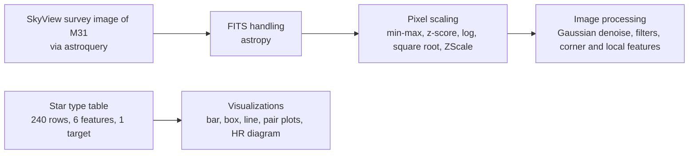

# Galactic Insights: Astronomical Data, Image Processing and Normalization

Three notebooks on working with astronomical data in Python: FITS images and pixel scaling, image filtering and feature detection on the M31 (Andromeda) galaxy, and visualizing a tabular star dataset.



## Notebooks

| Notebook | Covers |
|---|---|
| `FITS_File_and_Pixel_Scaling.ipynb` | What a FITS image is, querying SkyView with `astroquery`, building your own FITS file, and five ways to rescale pixels (min-max, standardization, log, square root, `ZScaleInterval`) |
| `Image_Processing.ipynb` | Gaussian denoising, filters that enhance linear features, and feature detection with `scikit-image` (Foerstner corners, multiscale local features) |
| `Astronomical_Tabular_Data_Visualization.ipynb` | Exploring a 240-row star dataset (temperature, luminosity, radius, absolute magnitude, star type): count plots, outlier boxplots, line plots, pair plots and a Hertzsprung-Russell diagram |

## Run it

```bash
pip install astropy astroquery opencv-python scikit-image scipy numpy pandas matplotlib seaborn jupyter
jupyter notebook
```

The notebooks were written in Google Colab and one reads a file from `/content`, so some paths need adjusting when run locally.

## Stack

`Python` `astropy` `astroquery` `OpenCV` `scikit-image` `SciPy` `NumPy` `pandas` `Matplotlib` `Seaborn`
